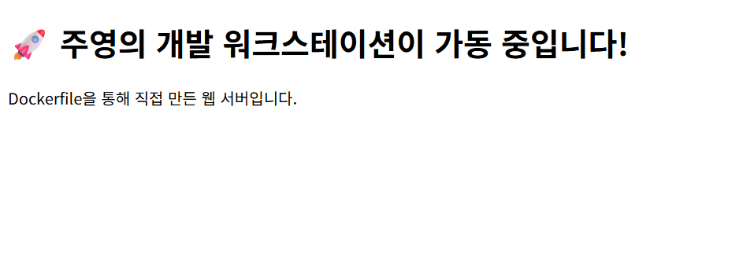

# 🚀 개발 워크스테이션 구축 및 웹 서버 배포 프로젝트


이 프로젝트는 Docker, Git, 그리고 Ubuntu(WSL2) 환경을 활용하여 기본적인 개발 워크스테이션을 구축하고, 간단한 웹 서버를 컨테이너화하여 배포하는 과정을 담고 있습니다.

## 🛠 사용 기술 및 환경
- **OS**: Windows 11 (WSL2 - Ubuntu 22.04 LTS)
- **Tools**: Docker Desktop, VSCode, Git
- **Language/Server**: HTML, Nginx (Docker Image)

## 📂 프로젝트 구조
```text
.
├── index.html          # 웹 서버 메인 페이지
├── Dockerfile          # Docker 이미지 빌드 설정
├── result.png          # 실행 결과 캡처 이미지
└── README.md           # 프로젝트 문서
```

## ⚙️ 실행 방법
1. 도커 이미지 빌드
`docker build -t my-web-server .`

2. 도커 컨테이너 실행
`docker run -d -p 8081:80 my-web-server`
브라우저에서 `localhost:8081` 로 접속하여 확인합니다.

## 📸 실행 결과


## 🔍 트러블슈팅 및 해결
1. Docker 권한 문제 (Permission Denied)
문제: Ubuntu 환경에서 docker ps나 빌드 시 권한 오류 발생.
원인: 기본적으로 Docker 데몬은 root 권한이 필요함.
해결: /var/run/docker.sock 파일의 권한을 변경하여 해결.
```
sudo chmod 666 /var/run/docker.sock
```
## 🎓 주요 학습 내용

**WSL2 & Ubuntu**: 윈도우 환경에서 리눅스 개발 환경을 구축하는 법을 익힘.

**Docker**: Dockerfile을 작성하여 나만의 웹 서버 이미지를 만들고 컨테이너화함.

**Git & GitHub**: 로컬 작업물을 원격 저장소에 관리하고 협업 환경을 이해함.

**VSCode Remote**: WSL2와 VSCode를 연동하여 효율적인 개발 워크플로우를 구축함.