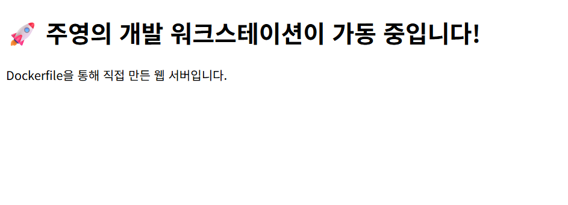
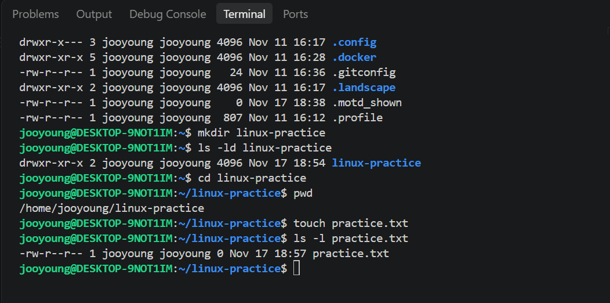
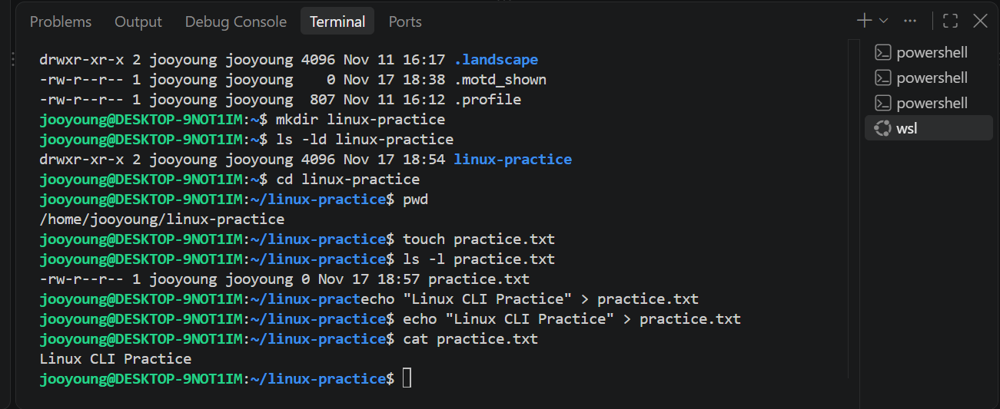
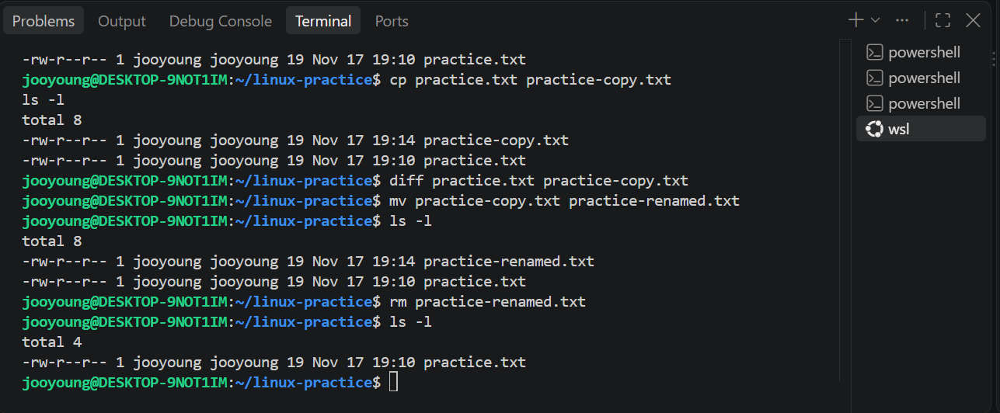
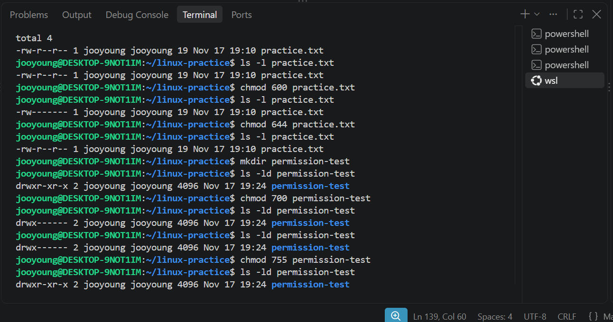
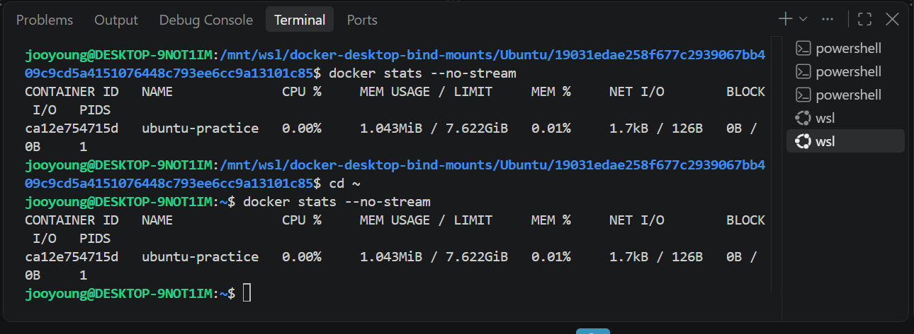
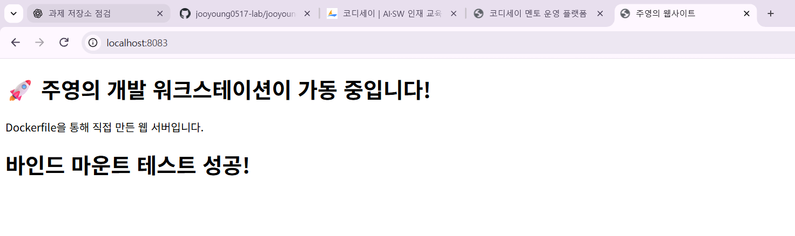
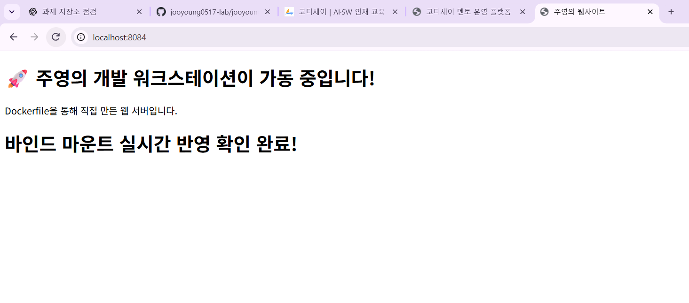

# 🚀 개발 워크스테이션 구축 및 웹 서버 배포 프로젝트


이 프로젝트는 Docker, Git, 그리고 Ubuntu(WSL2) 환경을 활용하여 기본적인 개발 워크스테이션을 구축하고, 간단한 웹 서버를 컨테이너화하여 배포하는 과정을 담고 있습니다.

## 🛠 사용 기술 및 환경
- **OS**: Windows 11 (WSL2 - Ubuntu 22.04 LTS)
- **Tools**: Docker Desktop, VSCode, Git
- **Language/Server**: HTML, Nginx (Docker Image)

## 📂 프로젝트 구조
```text
.
├── index.html          # 웹 서버 메인 페이지
├── Dockerfile          # Docker 이미지 빌드 설정
├── result.png          # 실행 결과 캡처 이미지
└── README.md           # 프로젝트 문서
```

## ⚙️ 실행 방법

### 1) 기본 컨테이너 실행
`docker run -d -p 8081:80 my-web-server`
- `localhost:8081`에서 확인 가능

### 2) 바인드 마운트 실행 (실시간 수정 모드)
`docker run -d -p 8082:80 -v "$(pwd):/usr/share/nginx/html" --name web-mount nginx`
- `localhost:8082`에서 확인 가능하며, 소스 코드 수정 시 즉시 반영됩니다.

## 📸 실행 결과


## 🔍 트러블슈팅 및 해결
1. Docker 권한 문제 (Permission Denied)
문제: Ubuntu 환경에서 docker ps나 빌드 시 권한 오류 발생.
원인: 기본적으로 Docker 데몬은 root 권한이 필요함.
해결: /var/run/docker.sock 파일의 권한을 변경하여 해결.
```
sudo chmod 666 /var/run/docker.sock
```

2. GitHub Push 인증 실패 문제 (Problem): git push 실행 시 GitHub 아이디와 비밀번호를 입력했으나 Authentication failed 오류가 발생하며 권한 거부됨.
원인 가설 (Hypothesis): GitHub의 보안 정책 변경으로 인해 일반 계정 비밀번호로는 터미널에서 인증할 수 없고, 별도의 토큰(PAT)이 필요할 것으로 추측함.
확인 (Verification): GitHub 공식 문서 및 에러 메시지를 확인한 결과, 2021년부터 비밀번호 인증 지원이 중단되었음을 확인.
해결/대안 (Solution): GitHub 계정 설정(Developer Settings)에서 **Personal Access Token (Classic)**을 생성하고, 권한(repo)을 부여한 뒤 비밀번호 대신 토큰 값을 입력하여 인증 성공.

## 🎓 주요 학습 내용

- **WSL2 & Ubuntu**: 윈도우 환경에서 리눅스 개발 환경을 구축하는 법을 익힘.

- **Docker**: Dockerfile을 작성하여 나만의 웹 서버 이미지를 만들고 컨테이너화함.

- **Git & GitHub**: 로컬 작업물을 원격 저장소에 관리하고 협업 환경을 이해함.

- **VSCode Remote**: WSL2와 VSCode를 연동하여 효율적인 개발 워크플로우를 구축함.

- **바인드 마운트 실습**:
    - **목적**: 호스트와 컨테이너의 디렉토리를 연결하여 소스 코드 수정 시 실시간 반영 확인
    - **명령어**: `docker run -d -p 8082:80 -v "$(pwd):/usr/share/nginx/html" --name web-mount nginx`
    - **결과**: `index.html` 수정 후 새로고침 시 즉각 반영됨 (성공)

    ## 리눅스 기본 명령어 실습

### 실습 목적
리눅스 터미널에서 현재 경로 확인, 디렉토리 생성 및 이동, 빈 파일 생성을 실습했습니다.

### 실행 명령어
```bash
pwd
ls -la
mkdir linux-practice
ls -ld linux-practice
cd linux-practice
pwd
touch practice.txt
ls -l practice.txt
```

### 실행 결과
- 작업 경로: `/home/jooyoung/linux-practice`
- `linux-practice` 디렉토리 생성 및 이동 성공
- `practice.txt` 빈 파일 생성 성공 (0바이트)

### 실행 증거


### 파일 내용 입력 및 확인

**실습 목적:** `echo` 명령어로 파일에 내용을 저장하고 `cat` 명령어로 결과를 확인한다.

**실행 명령어**
```bash
echo "Linux CLI Practice" > practice.txt
cat practice.txt
```

**실제 출력 결과**
```text
Linux CLI Practice
```

**실습 결과:** `practice.txt` 파일에 문자열을 저장하고 다시 읽어오는 데 성공했다. `>` 기호는 명령어의 출력을 파일에 저장하며, 기존 내용이 있으면 덮어쓴다.

**실행 증거**


### 파일 복사, 비교, 이름 변경 및 삭제

**실습 목적:** 리눅스 CLI를 사용해 파일을 복사하고, 내용이 동일한지 확인한 뒤 이름을 변경하고 삭제한다.

**실행 명령어**
```bash
cp practice.txt practice-copy.txt
ls -l
diff practice.txt practice-copy.txt
mv practice-copy.txt practice-renamed.txt
ls -l
rm practice-renamed.txt
ls -l
```

**실제 최종 출력 결과**
```text
total 4
-rw-r--r-- 1 jooyoung jooyoung 19 Nov 17 19:10 practice.txt
```

**실습 결과 분석**
- `cp`: 원본 파일을 복사하여 새 파일을 생성했다.
- `diff`: 두 파일을 비교한 결과 차이가 없어 아무 내용도 출력되지 않았다.
- `mv`: 복사본의 이름을 `practice-renamed.txt`로 변경했다.
- `rm`: 이름을 변경한 복사본을 삭제했다.
- `ls -l`: 최종적으로 원본 파일만 남아 있음을 확인했다.

**실행 증거**


## 리눅스 파일 및 디렉토리 권한 변경 실습

### 1. 실습 목적
리눅스의 파일 및 디렉토리 접근 권한을 이해하고, `chmod` 명령어를 이용해 권한 변경 및 복원 과정을 검증한다.

### 2. 파일 권한 변경 (644 → 600 → 644)

**실행 명령어**
```bash
ls -l practice.txt
chmod 600 practice.txt
ls -l practice.txt
chmod 644 practice.txt
ls -l practice.txt
```

**실제 확인 결과**
```text
변경 전: -rw-r--r-- (644)
변경 후: -rw------- (600)
복원 후: -rw-r--r-- (644)
```

**결과 분석:** 644에서는 소유자에게 읽기·쓰기, 그룹과 기타 사용자에게 읽기 권한이 부여된다. 600으로 변경하면 소유자만 읽기·쓰기가 가능하다.

### 3. 디렉토리 권한 변경 (755 → 700 → 755)

**실행 명령어**
```bash
mkdir permission-test
ls -ld permission-test
chmod 700 permission-test
ls -ld permission-test
chmod 755 permission-test
ls -ld permission-test
```

**실제 확인 결과**
```text
변경 전: drwxr-xr-x (755)
변경 후: drwx------ (700)
복원 후: drwxr-xr-x (755)
```

**결과 분석:** 755에서는 소유자에게 모든 권한이 있고 그룹과 기타 사용자는 디렉토리 목록 조회 및 경로 접근이 가능하다. 700으로 변경하면 소유자에게만 접근 권한이 부여된다.

### 4. 권한 숫자의 의미
- `r` (Read): 읽기, 숫자 4
- `w` (Write): 쓰기, 숫자 2
- `x` (Execute): 파일 실행 또는 디렉토리 경로 접근, 숫자 1
- `755`: 소유자 7(4+2+1), 그룹 5(4+1), 기타 사용자 5(4+1)
- `644`: 소유자 6(4+2), 그룹 4, 기타 사용자 4

### 5. 실행 증거


**검증 결과:** 파일 및 디렉토리의 권한 변경과 복원이 정상적으로 수행됨을 확인했다.

## Docker 컨테이너 리소스 모니터링

실행 중인 Ubuntu 22.04 컨테이너의 CPU 및 메모리 사용량을 확인했습니다.

### 실행 명령어

```bash
docker stats --no-stream
```

### 실행 결과

- 컨테이너 이름: `ubuntu-practice`
- CPU 사용률: `0.00%`
- 메모리 사용량: `1.043MiB / 7.622GiB`
- 메모리 사용률: `0.01%`
- 프로세스 수(PIDS): `1`

### 실행 화면



실행 중인 컨테이너가 없을 때는 출력 결과가 없었지만, Ubuntu 컨테이너를 실행한 후 CPU 및 메모리 사용량을 확인할 수 있었습니다.


## Docker 웹 서버 구축 및 포트 매핑

### 1. Dockerfile 작성

Nginx 이미지를 기반으로 직접 작성한 HTML 파일을 웹 서버에 포함했습니다.

```dockerfile
FROM nginx:latest
COPY index.html /usr/share/nginx/html/index.html
```

### 2. Docker 이미지 빌드

```bash
docker build -t jooyoung-web:v1 .
```

실행 결과: `Building 0.5s (7/7) FINISHED`가 출력되어 이미지 빌드에 성공했습니다.

### 3. 웹 서버 컨테이너 실행

```bash
docker run -d --name jooyoung-web-test -p 8083:80 jooyoung-web:v1
```

호스트의 8083 포트를 컨테이너의 80 포트에 연결했습니다.

### 4. 실행 상태 확인

```bash
docker ps
```

확인 결과:

- 이미지: `jooyoung-web:v1`
- 컨테이너: `jooyoung-web-test`
- 상태: `Up`
- 포트 매핑: `0.0.0.0:8083->80/tcp`

### 5. 브라우저 접속 검증

Windows 브라우저에서 `http://localhost:8083`에 접속해 직접 작성한 HTML 페이지가 정상적으로 표시되는 것을 확인했습니다.



**검증 결과:** Dockerfile을 이용한 이미지 빌드, 컨테이너 실행, 포트 매핑 및 브라우저 접속에 성공했습니다.

참고: HTML에 표시된 '바인드 마운트 테스트 성공!' 문구만으로는 바인드 마운트가 검증되지 않으며, 해당 기능은 별도 실습에서 확인합니다.


## Docker 바인드 마운트 실습

### 1. 바인드 마운트 컨테이너 실행

```bash
docker run -d --name jooyoung-web-mount -p 8084:80 --mount "type=bind,source=$(pwd),target=/usr/share/nginx/html" nginx:latest
```

현재 프로젝트 폴더를 Nginx 컨테이너의 `/usr/share/nginx/html`에 연결했습니다.

### 2. 마운트 설정 확인

```bash
docker inspect jooyoung-web-mount --format '{{json .Mounts}}'
```

확인 결과:

- Type: `bind`
- Source: `/mnt/c/Users/김정은/codyssey/practice`
- Destination: `/usr/share/nginx/html`
- RW: `true`

### 3. HTML 변경 사항 반영 확인

호스트의 `index.html` 문구를 다음과 같이 수정했습니다.

```html
<h1>바인드 마운트 실시간 반영 확인 완료!</h1>
```

컨테이너 내부 파일을 다음 명령어로 확인했습니다.

```bash
docker exec jooyoung-web-mount cat /usr/share/nginx/html/index.html
```

컨테이너 내부에서 수정한 문구를 확인했고, `http://localhost:8084`에서도 동일한 문구가 표시되는 것을 확인했습니다. Docker 이미지 재빌드 없이 변경 사항이 반영됐습니다.



### 4. 트러블슈팅: 변경된 문구가 브라우저에 보이지 않음

- **현상:** `index.html`을 수정했지만 처음에는 브라우저에서 변경된 문구가 보이지 않았습니다.
- **진단:** `docker inspect`로 바인드 마운트 설정을 확인하고, `docker exec ... cat`으로 컨테이너 내부 HTML에 수정 내용이 반영됐는지 확인했습니다.
- **조치:** Chrome에서 `Ctrl + Shift + R`로 강력 새로고침했습니다.
- **결과:** `localhost:8084`에 수정한 문구가 정상 표시됐습니다.
- **배운 점:** 파일 마운트 문제와 브라우저 캐시 문제를 구분해 진단할 수 있습니다.

## Docker 볼륨 데이터 영속성 테스트

### 1. Docker 볼륨 생성

```bash
docker volume create jooyoung-data
```

### 2. 첫 번째 컨테이너에서 데이터 저장

```bash
docker run --rm -v jooyoung-data:/data ubuntu:22.04 sh -c 'echo "Docker Volume Persistence Test" > /data/test.txt && cat /data/test.txt'
```

실행 결과:

```text
Docker Volume Persistence Test
```

`--rm` 옵션으로 첫 번째 컨테이너는 실행 종료 후 자동 삭제됩니다.

### 3. 새로운 컨테이너에서 데이터 확인

```bash
docker run --rm -v jooyoung-data:/data ubuntu:22.04 cat /data/test.txt
```

실행 결과:

```text
Docker Volume Persistence Test
```

### 4. 실습 결과

첫 번째 컨테이너가 삭제된 후에도 새로운 컨테이너에서 동일한 볼륨의 파일을 읽었습니다. 이를 통해 Docker 볼륨의 데이터 영속성을 확인했습니다.

